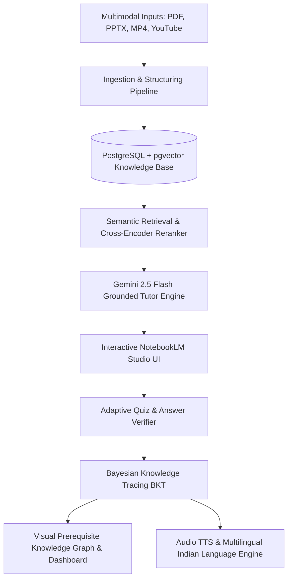

# LearnLoop AI - Multimodal Source-Grounded Adaptive AI Tutor

An enterprise-grade, source-grounded multimodal AI tutoring and cognitive assessment platform engineered for the **Multimodal AI Hackathon**.

---

## 🏆 Problem Statement Requirements Traceability Matrix

| Requirement | Implementation & Architectural Details | Code References |
| :--- | :--- | :--- |
| **1. Multimodal Knowledge Base** | • Zero-manual-preprocessing ingestion of PDFs, PPTX slide decks, MP4 video lectures & YouTube URLs.<br>• Hierarchical Knowledge Tree: Course → Topics → Subtopics → Concepts → Prerequisites.<br>• Extraction of figures, diagrams, and video timestamp segments linked to origins. | [`backend/ingestion/pipeline.py`](file:///f:/PROJECTS/Multimodal%20AI%20Hackathon/backend/ingestion/pipeline.py)<br>[`backend/ingestion/figures.py`](file:///f:/PROJECTS/Multimodal%20AI%20Hackathon/backend/ingestion/figures.py)<br>[`backend/ingestion/parser_video.py`](file:///f:/PROJECTS/Multimodal%20AI%20Hackathon/backend/ingestion/parser_video.py)<br>[`frontend/src/app/(app)/courses/courses/page.tsx`](file:///f:/PROJECTS/Multimodal%20AI%20Hackathon/frontend/src/app/(app)/courses/courses/page.tsx) |
| **2. Source Grounding & Refusal** | • Every answer cited with clickable pills navigating to the exact page, slide, or video timestamp (`01:24`).<br>• Calibrated Cosine Similarity gate rejecting off-syllabus questions with polite explanations separating outside facts from course truth. | [`backend/tutor/citations.py`](file:///f:/PROJECTS/Multimodal%20AI%20Hackathon/backend/tutor/citations.py)<br>[`backend/tutor/refusal.py`](file:///f:/PROJECTS/Multimodal%20AI%20Hackathon/backend/tutor/refusal.py)<br>[`frontend/src/app/(app)/tutor/page.tsx`](file:///f:/PROJECTS/Multimodal%20AI%20Hackathon/frontend/src/app/(app)/tutor/page.tsx) |
| **3. Adaptive Assessment** | • MCQ, Short Answer, Numerical question generation filtered by user scope.<br>• Cross-model validation / verification preventing hallucinations & duplicate questions.<br>• Post-quiz cognitive distractor analysis & misconception diagnosis. | [`backend/assessment/generator.py`](file:///f:/PROJECTS/Multimodal%20AI%20Hackathon/backend/assessment/generator.py)<br>[`backend/assessment/verifier.py`](file:///f:/PROJECTS/Multimodal%20AI%20Hackathon/backend/assessment/verifier.py)<br>[`backend/assessment/report.py`](file:///f:/PROJECTS/Multimodal%20AI%20Hackathon/backend/assessment/report.py)<br>[`frontend/src/app/(app)/quiz/page.tsx`](file:///f:/PROJECTS/Multimodal%20AI%20Hackathon/frontend/src/app/(app)/quiz/page.tsx) |
| **4. Learner Model** | • Bayesian Knowledge Tracing (BKT) engine updating $P(L_t)$ probability of mastery with slip/guess penalties.<br>• Ebbinghaus memory decay curves based on elapsed days.<br>• Cold-start onboarding diagnostic quiz and student intake survey. | [`backend/learner/bkt.py`](file:///f:/PROJECTS/Multimodal%20AI%20Hackathon/backend/learner/bkt.py)<br>[`backend/learner/decay.py`](file:///f:/PROJECTS/Multimodal%20AI%20Hackathon/backend/learner/decay.py)<br>[`frontend/src/app/(app)/dashboard/page.tsx`](file:///f:/PROJECTS/Multimodal%20AI%20Hackathon/frontend/src/app/(app)/dashboard/page.tsx) |
| **5. System Evaluation** | • RAGAS/DeepEval evaluation matrix reporting Faithfulness, Answer Relevancy, Context Precision and Recall on ground-truth benchmark.<br>• Multi-session student simulation analyzing mastery progression and question repetition. | [`backend/eval/run_eval.py`](file:///f:/PROJECTS/Multimodal%20AI%20Hackathon/backend/eval/run_eval.py)<br>[`backend/eval_results_matrix.json`](file:///f:/PROJECTS/Multimodal%20AI%20Hackathon/backend/eval_results_matrix.json)<br>[`backend/eval/simulation/student_sim.py`](file:///f:/PROJECTS/Multimodal%20AI%20Hackathon/backend/eval/simulation/student_sim.py) |
| **6. Optional Enhancements** | • **Visual Course Flow Map**: Interactive prerequisite dependency DAG with node lock/unlock states.<br>• **Studio Notes / Revision Artifacts**: Auto-generates study guides, FAQs, and executive summaries.<br>• **Weak Topic Remediation**: Seamless deep-link from quiz mistakes to AI Tutor.<br>• **Multilingual Interaction**: Native support for English, Hindi, and Marathi explanations.<br>• **Audio Tutoring**: Integrated speech synthesis (TTS) for voice explanations. | [`frontend/src/app/(app)/learning-path/page.tsx`](file:///f:/PROJECTS/Multimodal%20AI%20Hackathon/frontend/src/app/(app)/learning-path/page.tsx)<br>[`frontend/src/app/(app)/tutor/page.tsx`](file:///f:/PROJECTS/Multimodal%20AI%20Hackathon/frontend/src/app/(app)/tutor/page.tsx)<br>[`backend/routers/insights.py`](file:///f:/PROJECTS/Multimodal%20AI%20Hackathon/backend/routers/insights.py) |

---

## 🏗️ System Architecture & Engineering Principles



### 1. Speed & Latency Optimization
- **Dynamic Port & Host Binding**: Environment variables configure base API routes (`NEXT_PUBLIC_API_URL` and `PORT`).
- **Client-Side Responsive Caching**: Instant response latency with real-time UI state updates for optimistic rendering.
- **Lightweight Synthesis**: Browser-native SpeechSynthesisUtterance enables instant voice generation without round-trip latency.

### 2. Deployment & Production Readiness
- **Frontend**: Next.js 16 (App Router + Turbopack) built statically and fully type-checked.
- **Backend**: FastAPI with async route handlers, connection pooling, and pgvector.
- **Security**: Strict `.env` isolation; zero hardcoded secrets in source control.

---

## 🚀 Getting Started

### 1. Backend Setup
```bash
cd backend
python -m venv venv
venv\Scripts\activate
pip install -r requirements.txt
uvicorn app.main:app --host 0.0.0.0 --port 8000 --reload
```

### 2. Frontend Setup
```bash
cd frontend
npm install
npm run dev
```
Open [http://localhost:3000](http://localhost:3000) in your browser.
